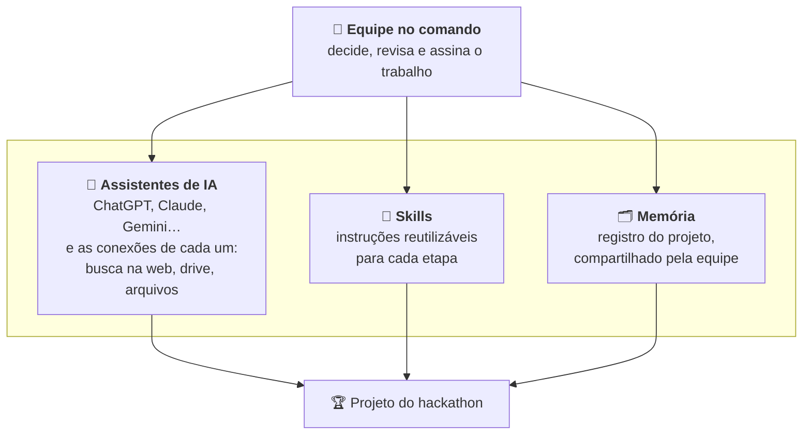

# Skills para Hackathon

Skills para assistentes de IA que ajudam equipes a passar por cada etapa de um hackathon: da pesquisa do problema até a entrega. Elas são genéricas: as regras de cada evento (prazos, critérios, entregáveis, o que desclassifica) vêm do regulamento que a própria equipe fornece.

## Os pilares



1. **Assistentes de IA:** conhecer o assistente que a equipe vai usar e o que ele consegue acessar (busca na web, drive, arquivos, documentos, código). Isso define como cada skill é carregada e onde a memória fica guardada.
2. **Skills:** saber usar as skills deste repositório e criar as suas. Uma skill é só um arquivo de instruções que o assistente segue numa tarefa repetível.
3. **Memória:** manter o registro do projeto, para que cada conversa, etapa e integrante parta do que já foi decidido, e não do zero.
4. **Equipe no comando:** conduz os outros três. A IA pesquisa, propõe e acelera; a equipe escolhe, confere fontes e responde pelo projeto. Muitos regulamentos desclassificam projetos sem autoria da equipe.

## As skills

| Skill | Etapa | O que entrega | Tempo sugerido |
|---|---|---|---|
| `pesquisa-problema` | Pesquisa | Desafio escolhido, persona, declaração do problema, evidências com fonte | ~15–20% |
| `desenho-solucao` | Modelagem | Proposta de valor, diferencial, momento "uau", fluxo de telas, escopo mínimo, viabilidade | ~15–20% |
| `prototipo` | Protótipo | Abordagem, prompts para geradores de app, dados de demonstração, testes da demo | ~30–35% |
| `roteiro-pitch` | Pitch | Roteiro cronometrado, abertura forte, plano de slides e gravação | ~20–25% |
| `avaliacao-jurado` | Qualquer etapa e entrega | Nota por critério, riscos de desclassificação, prioridades, checklist de entrega | — |

Reserve os minutos finais (cerca de 5–10%) para a entrega, com uma versão de segurança enviada antes do prazo.

## Como as skills se conectam

Todas leem e escrevem um **registro do projeto**: um único documento, com uma seção por etapa:

```
## Regras      ← criada pela primeira skill usada, a partir do regulamento
## Problema    ← pesquisa-problema
## Solução     ← desenho-solucao
## Protótipo   ← prototipo
## Pitch       ← roteiro-pitch
## Revisões    ← avaliacao-jurado
```

As skills definem **o que** guardar, não **onde**. Cada assistente usa o lugar mais durável que tiver, nesta ordem:

1. o lugar que a equipe indicou;
2. um arquivo `PROJETO.md`, se o assistente tem acesso a arquivos ou a um repositório;
3. um documento "Registro do projeto", se o assistente pode criar documentos (num drive conectado, numa área de documentos ou artefatos, num canvas);
4. um bloco em Markdown no fim da resposta, para a equipe salvar e colar na próxima conversa.

A skill sempre diz onde salvou o registro.

**Equipes com mais de uma pessoa:** escolham **um único lugar compartilhado** para o registro (um documento na nuvem ou um repositório) e informem esse lugar ao assistente logo na primeira conversa. Cada integrante pode usar um assistente diferente; o registro é o que mantém todos alinhados.

**Dica:** comece colando o regulamento do hackathon. As skills usam os critérios de avaliação e as regras de desclassificação dele em todas as etapas.

## Como usar

Cada skill é um arquivo Markdown (`skills/<nome>/SKILL.md`) com instruções em texto simples. Funciona com qualquer assistente de IA.

### Assistentes que aceitam skills no formato `SKILL.md`

Várias ferramentas já leem pastas de skills nesse formato (um `SKILL.md` com `name` e `description` no cabeçalho). Copie as pastas de `skills/` para o diretório de skills da sua ferramenta, conforme a documentação dela. O assistente aciona cada skill sozinho, pelo que a equipe pede.

### Qualquer chat de IA

1. Abra o `SKILL.md` da etapa em que a equipe está.
2. Copie o conteúdo e cole no início da conversa, ou nas instruções personalizadas de um projeto ou assistente customizado, se a ferramenta tiver esse recurso. Também dá para anexar o arquivo.
3. Cole o regulamento do hackathon e o registro do projeto, ou diga onde ele está.
4. Ao terminar a etapa, confira se a seção nova foi salva no registro e abra uma nova conversa para a próxima etapa.

## Exemplos de pedidos

- "Aqui está o regulamento e os desafios. Qual desafio devemos escolher?"
- "Vamos desenhar o fluxo de telas da solução."
- "Escreva o prompt para o Lovable criar o protótipo."
- "Monte o roteiro do vídeo de 3 minutos."
- "Avalie nosso projeto como um jurado. Faltam 2 horas."
- "Vamos enviar. Passe o checklist de entrega."

## Princípio: a IA ajuda, a equipe decide

Muitos regulamentos desclassificam projetos sem autoria da equipe. As skills propõem opções e fazem perguntas, mas deixam as decisões com a equipe e as anotam no registro do projeto.
