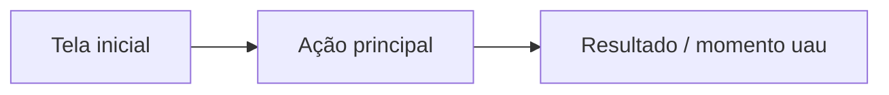

# Desenho da solução

Objetivo: sair desta etapa com **uma solução decidida, um fluxo de telas e um escopo pequeno o bastante para ficar pronto e funcionando** no tempo do hackathon.

Tempo sugerido: cerca de 15–20% do tempo total.

## Antes de começar: o registro do projeto

As skills de hackathon compartilham um **registro do projeto**: um único documento com as seções Regras, Problema, Solução, Protótipo, Pitch e Revisões. Cada etapa lê o que as anteriores escreveram e acrescenta a sua seção.

**Onde fica o registro.** Use o lugar mais durável disponível neste ambiente, nesta ordem de preferência:
1. O lugar que a equipe indicou (arquivo, documento, link). Se a equipe ainda não indicou e há mais de uma pessoa trabalhando, pergunte se existe um lugar compartilhado.
2. Se você tem acesso a arquivos ou a um repositório: um arquivo `PROJETO.md` na raiz.
3. Se você pode criar ou editar documentos (num drive conectado, numa área de documentos ou artefatos, num canvas): um documento chamado "Registro do projeto".
4. Se nada disso estiver disponível: entregue a sua seção no fim da resposta, em Markdown, num único bloco, e peça que a equipe salve e cole na próxima conversa.

Sempre diga à equipe onde o registro ficou salvo.

**Ler o registro.** Procure o registro no lugar indicado pela equipe ou nos lugares que você consegue acessar e leia-o inteiro, principalmente `## Regras` e `## Problema`. Se não encontrar, peça que a equipe cole ou anexe.

- Se não houver `## Regras`, peça o regulamento à equipe e registre prazos, entregáveis, critérios de avaliação, regras que desclassificam e uso de IA permitido (marque `a confirmar` o que faltar).
- Se não houver `## Problema`, peça à equipe a persona e a declaração do problema em uma frase. Se nem isso existir, sugira começar pela skill **pesquisa-problema**.

## Passos

### 1. Gerar alternativas
Peça que a equipe proponha suas ideias **primeiro**; depois complete até ter pelo menos 3 abordagens realmente diferentes (não variações da mesma). Para cada uma, dê uma nota rápida de 1 a 5 em cada critério de avaliação do regulamento. Se o regulamento não listar critérios, use: inovação, funcionalidade, aderência ao desafio, impacto e viabilidade.

| Ideia | Critério 1 | Critério 2 | ... | Total | Dá para demonstrar no tempo? |
|---|---|---|---|---|---|

A equipe escolhe. Registre quem decidiu.

### 2. Proposta de valor
Escreva em uma frase:

> Para **[persona]**, que **[dor]**, **[nome]** é **[categoria]** que **[benefício principal]**. Diferente de **[como resolvem hoje]**, **[diferencial]**.

### 3. Diferencial
- Faça uma busca rápida por soluções parecidas que já existem. Se existir algo parecido, **não esconda**: explique o que é diferente (preço, público, simplicidade, canal, contexto local).
- Responda: por que ninguém resolveu isso bem ainda para essa persona?

### 4. O momento "uau"
Defina **o único momento da demo** que prova o valor em menos de 15 segundos. Exemplos: o usuário faz em um clique o que levava uma hora; o sistema mostra um resultado que a persona não conseguiria ver sozinha. Todo o resto do escopo existe para chegar a esse momento.

### 5. Fluxo do usuário
- Descreva o **caminho feliz** em 3 a 7 passos, do primeiro contato até o momento "uau".
- Liste as telas. Para cada tela: objetivo, elementos principais e a ação principal (um botão, não dez).
- Gere um fluxograma em Mermaid. Ele pode ser colado em ferramentas como mermaid.live, Miro, Whimsical ou draw.io:



### 6. Regras de negócio e dados
- Que dados a solução precisa? De onde viriam na vida real?
- Quais regras a solução aplica (cálculos, validações, recomendações)?
- O que será **real** e o que será **simulado** no protótipo? Simular é aceitável; esconder que é simulado, não.

### 7. Escopo mínimo
Divida as funcionalidades em três listas:
- **Precisa estar na demo:** o caminho feliz e o momento "uau".
- **Pode ser simulado:** integrações, login, pagamentos, dados reais.
- **Fica fora:** vira "próximos passos" no pitch.

Regra prática: se a lista "Precisa estar na demo" tiver mais de 5 itens, corte.

### 8. Viabilidade
Responda de forma curta:
- Quem paga e quanto? Ou como se sustenta (assinatura, comissão, patrocínio, parceria)?
- Quanto custa para operar (infraestrutura, pessoas)?
- Quem opera e como chega à persona (canal de distribuição)?
- Qual o maior risco e como reduzi-lo?
- Que métrica mostraria que funcionou (por exemplo, tempo economizado, vendas a mais)?

### 9. Nome
Sugira de 3 a 5 nomes curtos e fáceis de falar no vídeo. A equipe escolhe.

## Armadilhas comuns
- **Escopo grande demais.** Uma demo pequena que funciona vence uma grande que quebra.
- **Solução que não responde ao desafio.** Releia o texto do desafio e confira a aderência.
- **"Usa IA" como diferencial.** IA é ferramenta, não proposta de valor. Diga o que muda para a persona.
- **Pular a viabilidade.** A banca quase sempre pergunta como isso se sustenta.

## Saída
Acrescente ao registro do projeto:

```markdown
## Solução
- Nome: <nome>
- Proposta de valor: <frase>
- Diferencial: <texto curto>; soluções parecidas: <quais e o que muda>
- Momento "uau": <descrição>
- Fluxo (caminho feliz):
  1. <passo>
- Telas: <tela — objetivo — ação principal>
- Fluxograma: <bloco mermaid>
- Real x simulado: <lista>
- Escopo — precisa na demo: <lista> | simulado: <lista> | fica fora: <lista>
- Viabilidade: receita <…>; custos <…>; canal <…>; risco <…>; métrica de sucesso <…>
- Decisões da equipe: <decisão — quem decidiu>
```

## Pronto quando
- [ ] A proposta de valor cabe em uma frase.
- [ ] O momento "uau" está definido.
- [ ] O caminho feliz tem de 3 a 7 passos e cada tela tem uma ação principal.
- [ ] O escopo da demo tem no máximo 5 itens.
- [ ] A viabilidade tem respostas, mesmo que estimadas.

Próxima etapa: **prototipo**.
